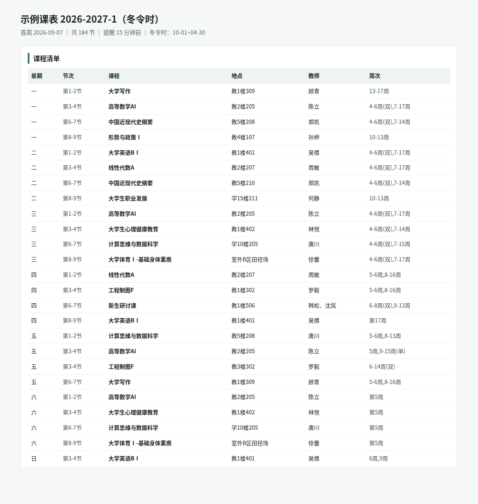

# syllabus-to-ics

把高校课表（教务系统 PDF / 文本 / 表格）转成可导入**苹果日历、Google 日历、Outlook** 的 `.ics` 文件：教室可定位、教师进备注、课前 15 分钟提醒、军训与考试周设为全天。

不是"能生成 ics"，而是**一节不差**。

```
配置应有 184 节 | ICS 实有 184 节 | 全天 3 条
缺失 0 | 多余 0 | 字段不符 0 | 无提醒 0
静态体检： CRLF=✅ 行宽≤75=✅ UTC=✅
结论： ✅ 全部对得上
```

生成的总表（可直接拿去核对每节课）：



## 为什么需要它

国内课表有三层坑，随便哪一层踩了，日历都会"看起来少了几节课"：

1. **周次规则**：`4-6周(双),7-17周` 这种写法要展开成逐次日历事件，单双周不能排错
2. **冬夏令时**：同一天不同节次可能分属两套作息，10 月 1 日当天切换，按周切就会错
3. **.ics 的隐蔽限制**：UID 撞车会被 Apple 静默合并（丢事件）、`TZID` 解析失败会整体偏移 8 小时、长行折叠切坏中文会乱码

`syllabus-to-ics` 把这三层都做成了代码 + 自动对账。

## 安装

**从压缩包（推荐给不熟悉 git 的人）**

```bash
# macOS / Linux
unzip syllabus-to-ics-skill.zip -d syllabus-to-ics && cd syllabus-to-ics && bash install.sh

# Windows PowerShell
# 解压后进入目录，执行 .\install.ps1
```

脚本会自动装进 `~/.codebuddy/skills/` 或 `~/.claude/skills/` 并跑 7 项自检。详见 [LOCAL-SETUP.md](LOCAL-SETUP.md)。

**从源码**

```bash
git clone https://github.com/<you>/syllabus-to-ics.git
cd syllabus-to-ics
pip install pymupdf      # 只有读 PDF 需要；文本输入不需要任何依赖
```

零第三方依赖运行：`scripts/build.py`、`scripts/audit.py`、`scripts/icsgen.py` 全部只用标准库（Python 3.9+）。

## 快速开始

```bash
# 1. 课表 PDF -> 配置草稿
python3 scripts/parse_text.py --pdf 课表.pdf -o draft.json

# 2. 补 term / periods / seasons（见下）
$EDITOR draft.json

# 3. 生成
python3 scripts/build.py -c draft.json -o 课表.ics -r 报告.md --html 总表.html

# 4. 对账（必须）
python3 scripts/audit.py -c draft.json -i 课表.ics
```

拿完整示例试跑（19 周 · 184 节课，结构取自真实校历与作息，数据已脱敏）：

```bash
python3 scripts/build.py -c assets/example-university-2026-fall.config.json \
        -o demo.ics -r demo.md --html demo.html
python3 scripts/audit.py -c assets/example-university-2026-fall.config.json -i demo.ics
```

## 配置说明

```jsonc
{
  "calendar": {
    "name": "课表 2026-2027-1",           // 导入后的日历名
    "timezone": "+08:00",                 // 或 "Asia/Shanghai"
    "location_prefix": "示例大学"      // 拼在地点前，用于地图定位
  },

  "term": {
    "first_monday": "2026-09-07",         // 第一教学周的周一（校历查）
    "weeks": 19
  },

  "seasons": {
    "winter_ranges": [["10-01", "04-30"]] // 冬令时生效区间，可跨年；留空=全年同一作息
  },

  "periods": {                            // 节次 -> 起止时间，冬夏令时各一套
    "1-2": { "summer": ["08:00", "09:35"], "winter": ["08:00", "09:35"] },
    "6-7": { "summer": ["14:00", "15:35"], "winter": ["13:30", "15:05"] }
  },

  "holidays": [                           // 放假期间自动剔除课程
    { "start": "2026-10-01", "end": "2026-10-07", "name": "国庆节" }
  ],

  "alarm_minutes": 15,                    // 课前提醒；null = 不提醒

  "courses": [
    { "weekday": 1, "period": "3-4", "name": "高等数学AI",
      "weeks": "4-6周(双),7-17周", "campus": "主校区",
      "location": "教2楼205", "teacher": "陈立",
      "note": "教学班：示例261" }
  ],

  "allday": [                             // 无钟点事项，不编造时间
    { "summary": "军训", "start": "2026-09-14", "end": "2026-09-27",
      "description": "入学教育、军训，共2周" }
  ]
}
```

`weeks` 写法：`4-6周(双),7-17周`、`第5周`、`5周,9-15周(单)`、`6周,9周`、`1-16`、`3,5,7`。

## 生成的日历长什么样

- 标题：课程名
- 地点：`示例大学 主校区 教2楼205`（点开可直接导航；`教2楼` 是一个整体，别拆成 `教2 楼`）
- 备注：教师 / 节次与实际钟点（标注夏令时或冬令时）/ 第几周 / 教学班
- 提醒：课前 15 分钟（可改）
- 全天：军训、考试周、网络课程等 **不含任何编造的钟点**

## 脚本

| 脚本 | 作用 |
|---|---|
| `scripts/parse_text.py` | 课表 PDF/文本 → 配置草稿（认正方/URP 格子格式，支持同格多课） |
| `scripts/build.py` | 配置 → `.ics` + Markdown 报告 + HTML 逐日账本 |
| `scripts/audit.py` | 独立重算应有课程，与 `.ics` 逐格对账 |
| `scripts/icsgen.py` | ICS 写出层：UTC 时间、UID、75 字节折行、转义、CSV 校验 |

## 已知边界

- 只处理**周次制**课表；非周次（按日期直接排）的需自行展开到 `courses`
- 不解析"其他课程"里没有节次和地点的条目（网络课、实践学时），会打印 warning 交给人判断
- 调休补课（如"10 月 10 日上 10 月 7 日周三的课"）不会自动加：若该校课表已把补课排在周末，正常排即可；否则需手工在 `courses` 里加一条
- 学校作息若不是"节次区间"而是"每节独立"，把 `periods` 写成 `"3-3"`、`"4-4"` 即可

## 相关文档

- [SKILL.md](SKILL.md) —— 面向 AI Agent 的执行规范
- [references/pitfalls.md](references/pitfalls.md) —— 每个坑的复现与修法
- [references/config-reference.md](references/config-reference.md) —— 字段逐项说明
- [LOCAL-SETUP.md](LOCAL-SETUP.md) —— 本地安装、卸载、推 GitHub

## 许可

MIT。

仓库内的示例配置**完全脱敏**：校名、校区、教师、班级、学号均已替换为虚构值，仅保留公开的校历结构与作息时段规律（19 周学期、冬夏令时切换、单双周轮次）。真实课表请勿提交——`.gitignore` 已忽略 `draft.json` 与输出文件，但仍建议自建私有仓库。
